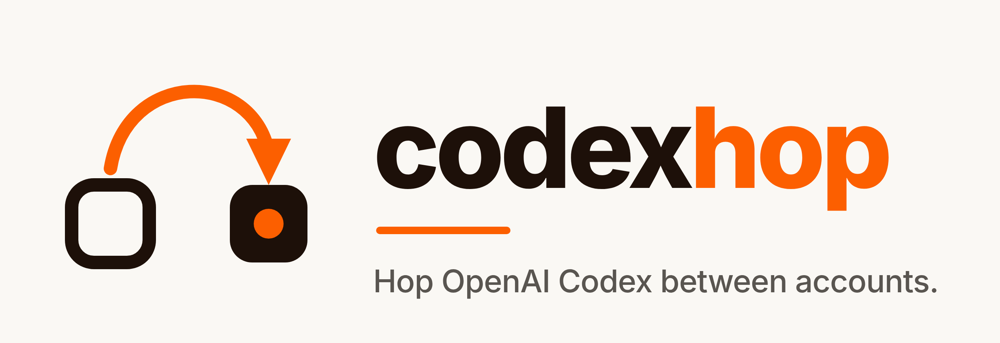

<p align="center">
  
</p>

<p align="center">
  <a href="https://pypi.org/project/codexhop/"></a>
  <a href="https://github.com/psychofict/codexhop/actions/workflows/ci.yml"></a>
  <a href="https://github.com/psychofict/codexhop/blob/main/LICENSE"></a>
  
  
</p>

codexhop lets you use several ChatGPT accounts with OpenAI Codex on one machine,
such as a personal plan and a seat in your company's workspace. It saves each
account's Codex login, swaps the live one in one command, and can run a
different account in each terminal. The same command can also hop on to Azure
OpenAI, Amazon Bedrock or another provider, and back.

The whole tool is one Python file with no dependencies. A browser opens only
when you add an account.

```
$ chop
      NAME  EMAIL           PLAN      5H USED
1.    home  me@gmail.com    plus      4%
2. *  work  me@company.com  business  62%

hop to which? [1-2, Enter to stay] 1
switched to home (me@gmail.com, plus)
new `codex` sessions start as this account.
```

`chop` is the short name the shell glue gives `codexhop`. The 5H USED column is
the last reading `chop usage` saved, so the menu comes up at once.

## Install

```bash
pipx install codexhop              # or: pip install --user codexhop
eval "$(codexhop shell-init)"      # the `chop` alias and tab completion
```

Put the `eval` line in your `~/.bashrc` or `~/.zshrc` and open a new terminal.
It needs Python 3.9 or newer and Codex, on Linux or macOS. For the newest code
from GitHub instead, use `pipx install git+https://github.com/psychofict/codexhop`.

To install from a clone instead, run `./install.sh`. It links
`~/.local/bin/codexhop` to the clone and adds the same line to your shell rc. If
`chop` is taken on your machine, `codexhop shell-init --alias NAME` picks
another name.

Then save the login you already have, and add the others:

```bash
chop save home       # names whatever is logged in right now
chop add work        # signs in as a second account, aside from the live one
```

`chop add` runs `codex login` in a private temporary Codex home, so your live
login is untouched while you sign in. If your browser is signed in to ChatGPT as
another account, that is the one you get. Open the link in a private window, or
use `chop add work --device-auth`.

## Commands

| Command | What it does |
|---|---|
| `chop` | list the accounts and ask which one to hop to |
| `chop <name>` | hop to that account |
| `chop add <name>` | sign in as another account and save it |
| `chop save [name]` | save the login you have now |
| `chop run <name> [...]` | run `codex` as that account or provider in this terminal only |
| `chop provider add <name> ...` | set up Azure OpenAI, Amazon Bedrock or another endpoint ([below](#azure-bedrock-and-other-providers)) |
| `chop provider [list]` | list the providers and whether each key variable is set in this shell |
| `chop usage [name]` | 5-hour and weekly usage, with reset times |
| `chop next [names]` | hop to another login in the list that has 5-hour room ([how it picks](https://github.com/psychofict/codexhop/blob/main/docs/commands.md#chop-next-names)) |
| `chop whoami` | who the live login is, read from the login itself |
| `chop list --long` | token expiry, last renewal and save date per account |
| `chop renew [name]` | renew the saved logins that are due |
| `chop doctor [--fix]` | check the setup and repair what it can |
| `chop rm`, `chop rename` | delete or rename a saved account |

The [command reference](https://github.com/psychofict/codexhop/blob/main/docs/commands.md)
covers every command, flag, setting, file and exit status.

### One account per terminal

`chop run work` starts `codex` as `work` in this terminal, while every other
terminal keeps the live login.

The session gets its own Codex home. That home holds the account's login and
links to everything else in yours, so the session has your config, rules,
skills and history, and `codex resume` sees the same conversations. When the
session ends, a login it renewed is saved back.

### Azure, Bedrock and other providers

A hop can go to a provider instead of a ChatGPT account. Set one up, then hop to
it like any account:

```bash
chop provider add azure --azure https://my-resource.openai.azure.com --model my-deployment
chop provider add bedrock --bedrock --region us-west-2
chop azure       # new `codex` sessions run on Azure
chop home        # and back to a ChatGPT account
```

```
$ chop
      NAME     EMAIL / PROVIDER                                    PLAN
1.    home     me@gmail.com                                        plus
2.    work     me@company.com                                      business
3. *  azure    azure, my-resource.openai.azure.com, my-deployment  provider
4.    bedrock  amazon-bedrock, us-west-2                           provider

hop to which? [1-4, Enter to stay]
```

A provider is a Codex profile file, `~/.codex/<name>.config.toml`, so a profile
you wrote yourself shows up too. codexhop asks for no key and writes none. Codex
reads an Azure key from the variable the profile names (`AZURE_OPENAI_API_KEY`
unless you pass `--env-key`), and Bedrock uses your AWS credentials; `--region`
and `--aws-profile` go in the profile. If a vault supplies the key, `chop
provider set azure --launcher 'my-codex-script'` makes codexhop start Codex
through that command instead.

Keep keys out of profiles and launchers. codexhop looks at the shape of what it
handles: `--env-key` refuses a value that looks like a key instead of a variable
name, and `provider set` refuses a launcher that sets a variable such as
`..._KEY` or `..._TOKEN`. When it lists a profile or launcher you wrote by hand,
it leaves out a key-like `env_key`, an address's user name, password, `?query`
and `#fragment`, and shows a key-like `NAME=value` as `NAME=***`. That catches the
common mistakes. It cannot recognise every key, so a secret you write into a
file yourself is still in that file.

Codex 0.166 has no setting that picks a default profile, so a hop to a provider
cannot change a file Codex reads when it starts. codexhop keeps a pointer, and
one more line in your shell rc lets plain `codex` follow it:

```bash
eval "$(codexhop shell-init --wrap-codex)"
```

That defines a `codex` function that runs `codex --profile <name>` after a hop to
a provider and plain `codex` otherwise. Your ChatGPT login is not touched, so
hopping back is immediate. Without the line, `chop run azure` still runs Codex on
the provider in one terminal. Codex started by an editor extension or an app does
not go through your shell's function, so it keeps using the ChatGPT login.

What has been checked: Codex 0.166.0 starts on these profiles and shows the
profile's model, through the `codex` function after a hop. Sending a request to
Azure or Bedrock this way has not been tested yet.

### Usage for every account

```
$ chop usage
   NAME  5 HOURS            WEEK                NOTE
*  home  4%  resets 3h19m   18%  resets 23h59m
   work  62%  resets 2h09m  41%  resets 23h59m
```

The figures come from the endpoint Codex reads an account's rate limits from. A
reading under
a minute old is shown again without asking, and a server that asks for a pause
is not asked again until the pause is over.

An idle account whose access token has run out is renewed first, so every
account can be read, not only the live one.

### In your menu bar, tray and dashboard

[codexwatch](https://github.com/psychofict/codexwatch), a Codex usage tracker
from the same maker, picks up codexhop when it finds it. Its dashboard, tray and
status-bar output show every account's last reading and the one with the most
room, its quota report names the account behind each plan window, and
`codexwatch limits --refresh` runs `codexhop usage` for you. codexhop does not
need it, and codexwatch opens no login file.

## What happens to sessions that are already open

A hop changes the login new `codex` sessions start with. A session that is
already open keeps the login it started with until that login's access token is
within 5 minutes of running out, about 10 days after its last renewal. Then it
stops with "signed in to another account. Please sign in again."

The exception is two logins in one workspace: there the open session moves to
the new login at that point.

This was measured with Codex 0.160.1 and 0.166.0, and
[How it works](https://github.com/psychofict/codexhop/blob/main/docs/how-it-works.md#what-open-sessions-do)
has the cases and the script. The hop tells you how long the open sessions have.
Start a new session to move over; `codex resume` reopens the conversation in it.

When a session is about to renew the live login, the hop stops and says so. A
hop that lands during that renewal can cost the account its login, because
Codex 0.166.0 drops the renewed tokens and 0.160.1 saves them under the new
account's workspace id. Let the session make its next request first, or pass
`--yes`.

## How it works

Codex keeps its login in `~/.codex/auth.json`. codexhop keeps one copy of that
file per account in `~/.codex/codexhop/accounts/`, mode 600, and copies the one
you want into place.

Which account a login belongs to is read from the login's own ID token (email,
ChatGPT user and workspace), so listing, hopping and `whoami` need no network.
During the swap codexhop holds `auth.lock`, the lock Codex 0.166.0 takes around
its own writes. The outgoing login is filed under the right account first, so a
renewal Codex has already saved is never overwritten.

[How it works](https://github.com/psychofict/codexhop/blob/main/docs/how-it-works.md)
goes through it step by step.

## Before you hop

- Codex can keep its login in the system keyring instead of `auth.json`. The
  file is the default; if yours is set to `keyring` or `auto`, codexhop says how
  to switch back.
- Codex before 0.164.0 does not check, when it saves a renewal, that
  `auth.json` still holds the same login (the check first appears in Codex's
  source at rust-v0.164.0). `chop doctor` warns about it, and
  `chop doctor --fix` repairs a file that got mixed up. Upgrading Codex closes
  the gap.
- `CODEX_ACCESS_TOKEN`, and `CODEX_API_KEY` in `codex exec`, take the place of
  the saved login. `chop whoami` and `chop doctor` warn when either is set.
- codexhop changes nothing about what each account may do. Use each one within
  OpenAI's terms of use.

## FAQ

**Does codexhop send my login anywhere?** Only to OpenAI, and only to renew it
(`auth.openai.com`) or to read usage (`chatgpt.com`), when a command needs to.
`CODEXHOP_OFFLINE=1` turns both off.
[SECURITY.md](https://github.com/psychofict/codexhop/blob/main/SECURITY.md)
lists what the tool holds and how it protects it.

**Can I hop between a ChatGPT login and an API key?** Yes. `chop add work
--with-api-key` reads the key from standard input, and the result hops like any
other account.

**Does it switch accounts by itself?** No. A hop happens only when you run
one, and `chop next` picks only from the list you gave it.
[codexwatch](https://github.com/psychofict/codexwatch)'s opt-in `autohop` can
run the hop for you between your own saved accounts when the live one is
nearly spent.

**Does it hop to Azure and Bedrock?** It sets up a hop to either one and starts
Codex on that profile; see
[Azure, Bedrock and other providers](#azure-bedrock-and-other-providers) for what
has and has not been tested. `--base-url` adds another endpoint that speaks the
Responses API.

**Two accounts with the same email?** One email in two ChatGPT workspaces is two
logins, and codexhop keeps them apart. `chop list` adds a WORKSPACE column when
that happens.

**Windows?** Windows is not supported. codexhop runs on Linux and macOS.

## Contributing and licence

Issues and pull requests are welcome. Start with
[CONTRIBUTING.md](https://github.com/psychofict/codexhop/blob/main/CONTRIBUTING.md),
and report anything that could expose a login through
[SECURITY.md](https://github.com/psychofict/codexhop/blob/main/SECURITY.md).

codexhop is built by [Ebenworks](https://ebenworks.co/), which also makes
[claudehop](https://github.com/psychofict/claudehop) for Claude Code and
[codexwatch](https://github.com/psychofict/codexwatch), which tracks Codex usage
and plan limits, and, with Statotech Systems, the
[Claude Usage Widget & Token Tracker](https://github.com/StaticB1/claude_ai_usage_widget)
for Claude Code.

MIT licence. Not affiliated with, endorsed by, or sponsored by OpenAI. "OpenAI",
"Codex" and "ChatGPT" are trademarks of OpenAI, used here only to say what this
works with.
